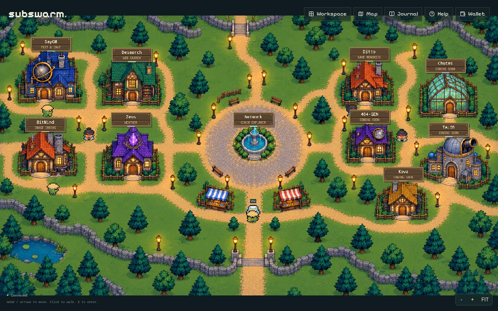
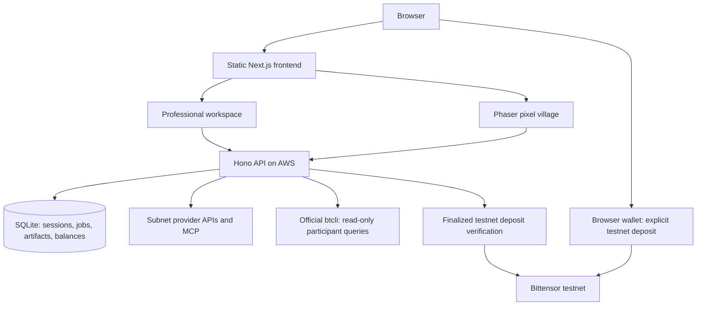

<p align="center">
  
</p>

<p align="center">
  <strong>Explore a village. Discover a subnet. Make something.</strong><br />
  A workspace and a playable world for Bittensor subnet services.
</p>

<p align="center">
  <a href="https://subswarm.vercel.app">Website</a> ·
  <a href="https://subswarm.vercel.app/app/">Open workspace</a> ·
  <a href="https://subswarm.vercel.app/village/">Enter village</a> ·
  <a href="services/api/README.md">API</a> ·
  <a href="deployments/README.md">Deployment</a>
</p>

---

Bittensor subnets offer different services, with different interfaces, credentials and outputs. SubSwarm brings a selected set into one place: find a service, give it a task, review the price and keep the result. Users do not need to set up each provider account themselves.

Use a conventional workspace when you want to get things done, or walk through a pixel village where subnet services have their own houses. Both share the same request flow, wallet balance and session library.

**Current release:** five hosted service integrations, a free Network Explorer and four coming-soon village houses. Requests use real provider APIs funded by the operator. The payment flow uses **Bittensor testnet TAO only**.

[Experience](#two-ways-in) · [Integrations](#what-you-can-use) · [Request flow](#how-a-request-works) · [Architecture](#architecture) · [Payments](#payments-and-trust) · [Quick start](#run-locally) · [Repository](#repository-guide)

## Two ways in

### The workspace

Search by subnet name, number or capability. Filter services, open a provider-specific form, inspect registered participants and find saved outputs in your library. Results include formatted text, source links, image assessments, weather forecasts and notes.


### The village

Explore three connected neighborhoods, walk up to a house and start a quest. Open the Map to search destinations, inspect residents or jump straight into a service. Directional walking animations, house signs and a pixel-themed journal make discovery part of the experience.



| Control | Action |
| --- | --- |
| WASD or arrow keys | Walk |
| Click the ground | Walk to a destination |
| E near an entrance, or select its sign | Open a house |
| Map | Search and select a district |
| FIT | Toggle the whole-map view |

Screenshots show the running interface. Provider availability and service limits can change.

## What you can use

| Service | Subnet | Give it | Get back |
| --- | --- | --- | --- |
| **SayGM** | SN 28 | A text prompt | A generated response |
| **Desearch** | SN 22 | A web search query | Results with sources |
| **BitMind** | SN 34 | A PNG or JPEG | An AI-image assessment and confidence score |
| **Zeus** | SN 18 | Coordinates and a forecast horizon | Hourly temperature forecasts |
| **Ditto** | SN 118 | A note | Saved memory you can retrieve or delete |
| **Network Explorer** | Selected testnet subnets | A supported subnet selection | A read-only participant snapshot |

The public catalogue is an explicit allowlist, not an index of every subnet. A configured connection does not guarantee that a provider has credits or is currently available. BitMind scores are assessments, not proof of an image's origin; Zeus returns forecasts, not live weather observations.

**Coming-soon houses:** Chutes for AI inference, 404-GEN for 3D creation, Kova for converting 2D CAD diagrams into 3D designs, and TALOS for collecting demonstration data to teach robots. These are discovery previews, not active quests. No request charge is taken from them.

### What the villagers represent

Residents come from a subnet's registered participants, read using official Bittensor tooling. A resident can expose its UID, hotkey and miner or validator role.

A roster does **not** prove who answered a particular request. Courier animations illustrate request progress; they do not invent competing miners, winners or execution attribution. Provider logos identify services and do not imply endorsement.

## How a request works

1. **Choose a service** in the workspace or its village house.
2. **Connect a wallet** and sign a login message. Talisman, SubWallet and Polkadot.js extensions are supported.
3. **Fund the service balance.** Explicitly claim a sponsored first request when available, or make a separate test-TAO deposit.
4. **Review a quote** for the exact inputs. The API reserves the quoted balance before calling the provider.
5. **Receive the result.** A successful result and its charge are saved together. Failed or interrupted requests release the reservation.
6. **Keep the output** in your session library and inspect charges in wallet activity.

The free Network Explorer does not require a paid quote. Switching between workspace and village on the same browser session preserves your work.

## Architecture



- **Frontend:** Next.js App Router, React, TypeScript, Tailwind and a client-only Phaser world. Vercel serves a static export and forwards `/v1/*` to AWS. No Vercel Functions or server actions.
- **Backend:** one Node.js/Hono process owns provider execution, SQLite transactions and recovery. Provider credentials stay on the server.
- **Chain access:** official `btcli` reads allowlisted metagraphs. Native testnet transfers are verified with the Polkadot API. Mainnet participant reads are read-only.
- **Shared contracts:** TypeScript request, response, result and payment types connect the frontend and API.

SubSwarm integrates existing subnet services. It does not operate a subnet, host an inference fleet or deploy its own smart contracts.

## Payments and trust

| Topic | Current behavior |
| --- | --- |
| Network | Testnet deposits only; no mainnet signing or transfers |
| Demo price | 1,000 rao, or **0.000001 test TAO**, per completed active service request |
| First request | Explicit **Claim free request** after wallet verification, subject to allocation |
| Provider costs | Paid separately from the operator's provider credits; providers do not automatically accept TAO |
| Custody | Deposits go to an operator-controlled receiver; SQLite tracks each wallet's service credit |
| Settlement | Reserve before execution; charge when a supported result is saved; release on failure |
| Refund meaning | Release back to the internal service balance, not an on-chain transfer |
| Withdrawals | Not implemented |
| Ownership | Balance and ledger belong to the verified wallet; jobs and artifacts belong to their browser session |

The API needs the receiver's public address, not its signing key. Deposits must be finalized, match the verified sender and configured receiver, and come from the pinned testnet. The same transfer event cannot credit twice.

The standard demo allocation is one 1,000-rao claim per verified wallet, up to 20 wallets per UTC day. A separate shared budget permits 20 provider attempts per UTC day and two concurrent provider jobs, including failed attempts. A wallet allowance is not proof of a unique person.

Test TAO does not pay the operator's real API bills. The demo tariff is subsidized. The repository includes an offline cost calculator for planning a future service margin; it does not implement live currency conversion or usage-based repricing. See [pricing and accounting](services/api/README.md#pricing-and-accounting).

**Session limits:** reconnecting a wallet restores its balance and ledger. It does not recover another cookie session's jobs or artifacts. Provider outputs are not guaranteed correct, and stored notes are not end-to-end encrypted.

## Run locally

Use **Node.js 22.x** and npm. From the repository root, on a fresh clone:

```bash
npm ci
cp apps/web/.env.example apps/web/.env.local
cp services/api/.env.example services/api/.env
```

Configure provider credentials only in `services/api/.env`. Do not overwrite an existing local env file. Payments and sponsored credit are disabled in the example configuration.

Start the API and frontend in separate terminals:

```bash
npm run dev:api
```

```bash
npm run dev
```

Open [localhost:3000](http://localhost:3000) for the landing page, `/app/` for the workspace and `/village/` for the world. The API listens on port **4100**. Without provider credentials, paid services remain unavailable; the interface can still be explored.

For participant queries, install the official Bittensor CLI in an isolated environment:

```bash
uv venv .runtime/btcli
uv pip install --python .runtime/btcli/bin/python bittensor==11.3.0
```

Set `BTCLI_BIN` in the API env to the **absolute path** of `.runtime/btcli/bin/btcli`. See [API setup](services/api/README.md#configuration) for provider fields and [testnet payment setup](services/api/README.md#testnet-payment-setup) before enabling deposits.

## Repository guide

| Directory | Responsibility | Documentation |
| --- | --- | --- |
| `apps/web` | Landing, workspace, village, wallet and results UI | [Frontend README](apps/web/README.md) |
| `services/api` | Provider execution, sessions, payments and persistence | [API README](services/api/README.md) |
| `packages/shared` | Shared TypeScript API contracts | [Shared types README](packages/shared/README.md) |
| `deployments` | Static frontend routing and AWS service operations | [Deployment README](deployments/README.md) |

There is no contract workspace because this release uses native testnet transfers and an application ledger.

## Development checks

```bash
npm run typecheck
npm run lint --workspace @subswarm/web
npm test --workspace @subswarm/api
npm run build
npm run check:setup --workspace @subswarm/api
```

The setup report checks configuration without spending provider credits. It does not prove API access, available credits or live wallet behavior. The web build produces `apps/web/out`; the API build produces `services/api/dist`. Run the API separately and persist its database. Deployment details, backups and release boundaries are in the [operations guide](deployments/README.md).

## For a quick walkthrough

Open the workspace, choose a service and inspect its input form. Then enter the village, find the same house and inspect its Residents tab. With a funded provider account and verified wallet, claim the available demo credit and complete one small request. Find the saved output in the library and its charge in wallet activity.

The project fits **Build with Bittensor Subnets**: it turns existing subnet capabilities into a user-facing product with two shared interfaces.

## Artwork and attribution

The village combines original background artwork with licensed character sprites. Fonts, reused source, provider marks and artwork sources are recorded in [Third-party notices](THIRD_PARTY_NOTICES.md). The README title is a static SVG with pixel lettering; screenshots come from the application itself.
