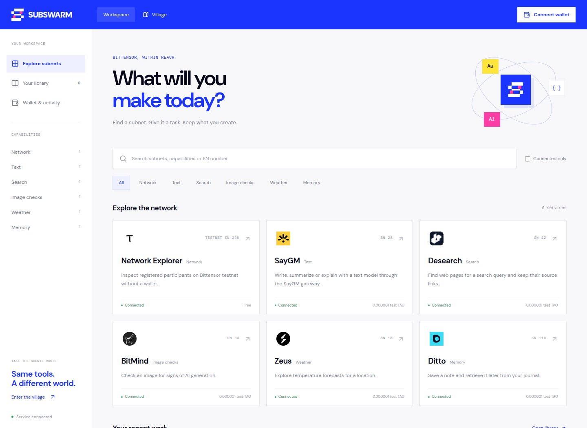

# SubSwarm frontend

[Project overview](../../README.md) · [API](../../services/api/README.md) · [Deployment](../../deployments/README.md)

One static Next.js application, two ways to use subnet services: a professional workspace and a playable pixel village. Both use the same API session, wallet, request lifecycle and saved outputs.



## Pages

| Route | Experience |
| --- | --- |
| `/` | Landing page with workspace and village entry points |
| `/app/` | Search, capability filters, provider forms, residents, wallet and library |
| `/village/` | Full-screen Phaser world, house interactions, searchable Map and journal |

Published service deep links work in both modes: `/app/?subnet=desearch` and `/village/?subnet=desearch`. Coming-soon houses are discovery previews with no request or payment form.

## Run locally

From the repository root, install dependencies and prepare the env files using the [quick start](../../README.md#run-locally). Then run these in separate terminals:

```bash
npm run dev:api
```

```bash
npm run dev
```

The frontend uses port **3000**. Set `NEXT_PUBLIC_API_URL=http://localhost:4100` in `apps/web/.env.local` and `WEB_ORIGIN=http://localhost:3000` in the API env. Origins must match exactly for authenticated mutations.

`NEXT_PUBLIC_API_URL` is public build-time configuration. It must never contain a credential. Provider keys belong only in the API environment.

## Code map

| Path | Responsibility |
| --- | --- |
| `src/app/` | Routes, layout and theme styles |
| `src/components/Landing.tsx` | Landing page |
| `src/components/Workspace.tsx` | Professional catalogue and request interface |
| `src/components/Village.tsx` | Village HUD, district selection and overlays |
| `src/hooks/useWorkspace.ts` | Shared session, wallet, jobs, catalogue and library state |
| `src/components/TaskPanel.tsx` | Provider-specific inputs and quote confirmation |
| `src/components/WalletPanel.tsx` | Wallet login, explicit credit claim, deposits and ledger |
| `src/components/ResultView.tsx` | Typed output rendering and result actions |
| `src/components/Journal.tsx` | Session-owned jobs and saved outputs |
| `src/components/Residents.tsx` | Registered participant roster |
| `src/game/WorldScene.ts` | Phaser scene, animation, movement and interactions |
| `src/game/village.ts` | Building positions, signs and coming-soon metadata |
| `src/game/navigation.ts` | Walkability and pathfinding |
| `src/lib/api.ts` | Credentialed HTTP client |
| `src/lib/wallet.ts` | Extension account selection, signatures and testnet deposits |

## Shared behavior, separate themes

The landing and workspace use the blue, white, pink and yellow brand palette. Their styles are scoped with `.swarm-brand` and `.professional`. The village retains its illustrated evening world, pixel fonts and parchment panels.

Keep presentation in the relevant surface and request behavior in `useWorkspace` and the shared components. A new visual mode must not create a second payment implementation or an independent balance.

Results render Markdown with `react-markdown` and `remark-gfm`, alongside typed cards for search results, forecasts, image assessments and stored notes. File or memory actions go through ownership-checked API routes.

## Village interaction

| Input | Action |
| --- | --- |
| WASD / arrow keys | Walk with directional sprite animation |
| Click ground | Follow a collision-aware path |
| E near a door / select a sign | Open the house |
| Map | Search names, subnet numbers and capabilities |
| FIT / zoom buttons | Change the world view |

The original 3360 by 1888 background spans three connected neighborhoods. The Map offers keyboard-accessible district selection without walking. Coming-soon houses include Chutes, 404-GEN, Kova and TALOS.

Phaser runs only in the browser. Keep `input.windowEvents` disabled so clicking DOM overlays does not also interact with the world. Movement pauses while users type or interact with dialogs.

Residents are registered chain participants. A roster or animation is not proof that a miner produced a request's result. The backend supplies available attribution; the world must not invent it.

## Wallet and session behavior

- Lazy-load wallet libraries when needed. Support Talisman, SubWallet and Polkadot.js native accounts.
- Login signs a challenge. Deposits require a separate wallet confirmation and are pinned to Bittensor testnet.
- Sponsored credit requires an explicit claim after login. Connecting alone issues no credit.
- Obtain a server quote for the exact inputs before a paid request. Render returned balances as exact rao-derived amounts.
- Reconnecting a wallet recovers its service balance and ledger. Jobs and artifacts still belong to their original cookie session.
- Keep private keys and provider credentials out of frontend code, bundles and public environment variables.

See [API accounting](../../services/api/README.md#testnet-payment-setup) for enforcement and custody boundaries.

## Build and deployment

```bash
npm run lint --workspace @subswarm/web
npm run typecheck --workspace @subswarm/web
npm run build --workspace @subswarm/web
```

`next.config.ts` enables `output: "export"` and trailing slashes. The build produces **`apps/web/out`** with a directory index for each page. Serve this directory as static files; `next start` is not the deployment path for this export.

The root Vercel configuration builds with `NEXT_PUBLIC_API_URL=/` and forwards `/v1/*` to AWS. There are no Next.js route handlers, server actions or Vercel Functions. Static hosting still incurs ordinary CDN traffic.

## Assets

Keep provider logos local with their source attribution. Use [world asset notes](public/worlds/README.md) for background provenance and the asset sources below for fonts, sprites and reused code. Do not replace a preview house's missing identity with an invented subnet number or logo.


<details>
<summary>Asset sources and attribution</summary>

### Village world

The Tiled world and adapted Phaser integration come from
[eth-open-agents](https://github.com/ritiklakhwani/eth-open-agents), revision
`cb94d12570fa0054f6ef58e2a529a9a33ee2c151`.
Its README and root package declare the MIT license. A separate copyright and
license file is not included in that revision. The original repository remains
the source of that declaration. Unrelated logos, audio, contracts, and services
are not included. The source repository background is not included in the active application.
The current evening town background was generated for this project, with new
entrances and collision geometry matched to it. Its static artwork contains no
provider output, participant identity, or simulated request evidence.

### Pixel art

Kenney Tiny Town is distributed under CC0. Its original license is retained in
`apps/web/public/tilesets/tiny-town/LICENSE.txt`.

Kenney Tiny Dungeon character artwork is distributed under CC0. Its original
license is retained beside the imported character assets. See
[the author's asset page](https://kenney.nl/assets/tiny-dungeon).

Ninja Adventure directional character sprites are distributed under CC0. The
active player, town couriers, and registered resident characters use unmodified
sheets from the [official asset source](https://pixel-boy.itch.io/ninja-adventure-asset-pack)
and its linked GitHub project, revision `6ac78232d5aedcc85ce5f27d060ea92366f7c24a`.
Source paths and license details are retained in
`apps/web/public/characters/ninja-adventure/LICENSE.txt`. These decorative sprites
do not identify an actual provider participant unless a registered UID is shown.

### Dependencies

Framework and library licenses remain with the respective installed packages.
The npm lockfile records exact resolved versions and integrity hashes.

### Interface font

Pixelify Sans is distributed under the SIL Open Font License 1.1. The font and
license are retained in `apps/web/public/fonts/pixelify-sans`, sourced from
[Google Fonts](https://github.com/google/fonts/tree/main/ofl/pixelifysans).

### Workspace typography and provider marks

Barlow Condensed and DM Sans are distributed under the SIL Open Font License.
Their licenses are retained alongside the fonts in `apps/web/public/fonts`.
Provider marks are used solely to identify the corresponding service, with no
endorsement implied. They remain the property of their respective owners.
Original download sources:

- `logos/saygm.svg`: https://saygm.com/favicon.svg
- `logos/desearch.png`: https://www.desearch.ai/favicon.png
- `logos/chutes.png`: https://chutes.ai/apple-icon.png?apple-icon.0gj39pa49futm.png
- `logos/attelier.svg`: https://attelier.ai/_next/static/media/attelier-icon-white.10suds3auaq0u.svg
- `logos/hippius.png`: https://console.hippius.com/icon1.png?b16d1f489d539a32
- `logos/ridges.png`: https://app.ridges.ai/logo.png
- `logos/everyframe.svg`: https://everyframe.studio/media/logo.svg
- `logos/network.ico`: https://www.bittensor.com/favicon.ico?7ca8cf782439c3f2
- `fonts/barlow/BarlowCondensed-BlackItalic.ttf`: https://raw.githubusercontent.com/google/fonts/main/ofl/barlowcondensed/BarlowCondensed-BlackItalic.ttf
- `fonts/barlow/OFL.txt`: https://raw.githubusercontent.com/google/fonts/main/ofl/barlowcondensed/OFL.txt
- `fonts/dm-sans/DMSans.ttf`: https://raw.githubusercontent.com/google/fonts/main/ofl/dmsans/DMSans%5Bopsz,wght%5D.ttf
- `fonts/dm-sans/OFL.txt`: https://raw.githubusercontent.com/google/fonts/main/ofl/dmsans/OFL.txt

### World outline

The landing board uses Natural Earth 1:110m land geometry, public domain.
Source: https://github.com/nvkelso/natural-earth-vector/blob/master/geojson/ne_110m_land.geojson
Terms: https://www.naturalearthdata.com/about/terms-of-use/
The visual network routes are decorative, not real provider locations or traffic.

The 404-GEN mark comes from its documented GitHub organization,
https://github.com/404-Repo, avatar https://avatars.githubusercontent.com/u/154099142?s=200&v=4.
ChronoSeek uses a capability icon because no verified brand asset was available.

### Provider identity marks

The following provider marks identify their respective services; they do not imply endorsement.

- BitMind: `apps/web/public/logos/bitmind.png`, retrieved from https://bitmind.ai/icons/favicon.png.
- Zeus: `apps/web/public/logos/zeus.png`, retrieved from https://docs.zeussubnet.com/icon.png.
- Ditto: `apps/web/public/logos/ditto.svg`, retrieved from https://heyditto.ai/assets/brand/app-icon.svg.

The backend uses the official Model Context Protocol TypeScript SDK 1.32.2 (MIT) for Ditto's documented Streamable HTTP API. No provider tokens enter the frontend.

</details>
