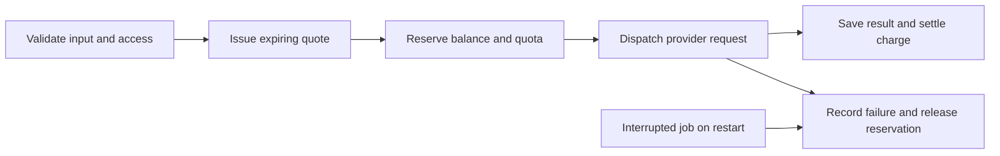

# SubSwarm API

[Project overview](../../README.md) · [Frontend](../../apps/web/README.md) · [Shared types](../../packages/shared/README.md) · [Deployment](../../deployments/README.md)

The Hono/Node.js service behind both SubSwarm interfaces. It owns sessions, provider execution, saved outputs, testnet deposit verification and the prepaid service ledger. SQLite persists state across restarts; provider credentials never enter the frontend.

## Run locally

From the repository root, follow the [quick start](../../README.md#run-locally), configure `services/api/.env`, then:

```bash
npm run dev:api
```

Default address: `http://localhost:4100`. The frontend's origin defaults to `http://localhost:3000`.

```bash
npm run check:setup --workspace @subswarm/api
npm run typecheck --workspace @subswarm/api
npm test --workspace @subswarm/api
npm run build --workspace @subswarm/api
```

After building, `npm start --workspace @subswarm/api` runs `dist/index.js`. The setup report checks configuration and CLI presence without calling providers, inspecting balances, creating jobs or printing credentials. `configured_unverified` means fields are present, not that access or credit has been verified.

## Configuration

The full placeholder list is in [.env.example](.env.example). Keep actual values in the ignored `.env` locally and outside release files on the server.

| Setting | Purpose |
| --- | --- |
| `PORT` | HTTP port, default `4100` |
| `WEB_ORIGIN` | Exact allowed browser origin |
| `DATABASE_PATH` | Persistent SQLite file; local default `data/subswarm.sqlite` |
| `BTCLI_BIN` | Official Bittensor CLI executable, preferably an absolute path |
| `PUBLISHED_PROVIDERS` | Explicit public catalogue allowlist |
| `MAX_DAILY_REQUESTS` / `MAX_CONCURRENT_JOBS` | Per-session request and concurrency limits |
| `MAX_PAID_DAILY_REQUESTS` / `MAX_PAID_CONCURRENT_JOBS` | Shared provider-attempt and concurrency limits |

The published catalogue is `network,saygm,desearch,bitmind,zeus,ditto`. Keys alone do not enable a service: publication, configuration and payment settings are separate checks. With payments enabled, a hosted service also needs a positive request price.

| Integration | Required configuration | Behavior |
| --- | --- | --- |
| Network Explorer | `BTCLI_BIN` | Allowlisted read-only metagraph queries |
| SayGM | `SAYGM_API_KEY`; optional `SAYGM_MODEL` | Text with bounded output tokens |
| Desearch | `DESEARCH_API_KEY` | Web search with source links |
| BitMind | `BITMIND_API_KEY` | PNG/JPEG assessment, up to 256 KiB |
| Zeus | `ZEUS_API_KEY` | Hourly temperature forecasts |
| Ditto | `DITTO_MCP_API_KEY`, dedicated `DITTO_SPACE` | Save, retrieve and delete session-owned notes |

BitMind validates file signatures before sending bytes to a fixed endpoint. It does not expose arbitrary remote image fetching. Zeus selects the free host for `free_` keys and the paid host otherwise; forecasts preserve timestamps and convert Kelvin to Celsius. A free-plan endpoint still requires valid access and remains subject to its limits.

Ditto uses the official MCP SDK. Use a dedicated space, never `main`. A saved note ID is bound to its server-owned job. Retrieval and deletion require that session's completed job; arbitrary memory IDs, tool calls and shared-account memory searches are not exposed. Deletion clears local output content while retaining the billing receipt. Notes are not end-to-end encrypted.

## Request lifecycle



The free network-scan route does not use a paid quote. For paid jobs, the quote binds the normalized inputs, wallet and session, expires after five minutes and is consumed by one job.

Reservation and cap checks are transactional. A successful job, its output artifact and its charge are committed together. An interrupted request fails on restart rather than silently repeating potentially billable work. An upstream provider may still finish or bill that request; SubSwarm releasing the reservation does not reverse the provider's bill.

Defaults are **40 requests per session per UTC day**, two active jobs per session, **20 shared provider attempts per UTC day** and two concurrent provider jobs. Failed attempts count. These limits bound requests, not dollar expenditure.

## HTTP API

Browser requests include credentials. Mutations require the configured Origin and a JSON body. Sessions use opaque httpOnly cookies; only token hashes are stored. Client-supplied IDs never grant ownership.

### Discovery and jobs

| Method | Route | Purpose |
| --- | --- | --- |
| GET | `/health` | Process liveness, not provider or chain readiness |
| GET | `/v1/session` | Create or resume the cookie session |
| GET | `/v1/providers` | Published capabilities, inputs and configured availability |
| GET | `/v1/providers/:id/residents` | Registered participants for a provider |
| GET | `/v1/networks/:network/:netuid` | Allowlisted metagraph snapshot |
| POST | `/v1/quotes` | Quote validated provider inputs |
| POST | `/v1/jobs` | Submit inputs, with `quoteId` for paid work |
| GET | `/v1/jobs` | This session's jobs |
| GET | `/v1/jobs/:id` | This session's job and result |
| GET | `/v1/artifacts` | This session's saved outputs |

### Wallet and payments

| Method | Route | Purpose |
| --- | --- | --- |
| GET | `/v1/wallet` | Wallet state and payment settings |
| POST | `/v1/wallet/challenge` | Create an expiring login challenge |
| POST | `/v1/wallet/verify` | Verify its signature |
| POST | `/v1/wallet/disconnect` | Remove this session's wallet binding |
| POST | `/v1/wallet/demo-credit` | Explicitly claim sponsored credit, empty JSON body |
| POST | `/v1/wallet/deposits` | Verify a finalized transfer receipt |
| GET | `/v1/wallet/ledger` | Verified wallet's deposits, sponsored credit and request charges |

### Owned results

| Method | Route | Purpose |
| --- | --- | --- |
| GET | `/v1/jobs/:id/memory` | Retrieve the owner's Ditto note |
| POST | `/v1/jobs/:id/memory/delete` | Delete its provider note and clear local content |
| GET | `/v1/jobs/:id/files/model` | Historical 404-GEN file download |
| GET | `/v1/jobs/:id/files/media/:index` | Historical Attelier media download |
| GET | `/v1/jobs/:id/files/storage` | Historical Hippius file download |
| POST | `/v1/jobs/:id/files/storage/delete` | Delete an owned stored file, preserving its receipt |

Historical result routes remain available for their owners even when an integration is no longer published. They do not enable new requests to that service.

## Testnet payment setup

Leave `TAO_PAYMENTS_ENABLED=false` until provider access, prices and the operator's credit budget are configured.

1. Prepare a dedicated Bittensor **testnet** receiver under your control. The API needs only its public address.
2. Set `TAO_TESTNET_RECEIVER` and `TAO_DEPOSIT_START_BLOCK`. Transfers before that height cannot fund the ledger.
3. Set a positive integer `TAO_PRICE_<PROVIDER>_RAO` for each enabled hosted integration. One TAO is **1,000,000,000 rao**.
4. Choose provider-attempt limits and, optionally, an explicit sponsored-credit allocation.
5. Enable `TAO_PAYMENTS_ENABLED=true` and restart the single API process.

The optional preparation script performs read-only chain checks and writes local configuration:

```bash
npm run prepare:testnet --workspace @subswarm/api
```

It verifies pinned testnet genesis, prepares an sr25519 receiver in ignored `.runtime/wallets/testnet-receiver.json` with mode 0600, and updates payment fields in the ignored API env. It preserves existing receiver, activation height and prices, refuses an already enabled setup, and does not submit a transaction or enable payments. Back up wallet material privately; the API never loads that key.

**The script's default price is 1,000,000 rao (0.001 test TAO).** This is distinct from the public demo's explicitly configured **1,000-rao** price. Review prices before activation; neither is a provider-cost estimate or currency conversion.

### Accounting guarantees and limits

- Wallet login verifies an expiring signed nonce bound to the session and origin. Proof expires after 24 hours.
- Deposits require a successful finalized native transfer from the verified wallet to the receiver, after the activation height, on pinned testnet genesis.
- Each transfer event credits once. Retrying a receipt cannot duplicate the credit.
- Balances, quotes and settlement use exact integer rao.
- Success settles the reservation; failure or interrupted-job recovery releases it to the internal balance.
- The receiver is operator-controlled. Deposits are pooled on-chain, with per-wallet claims recorded in SQLite. This is a **custodial prepaid service balance**.
- There is no withdrawal endpoint or automatic on-chain refund.
- Reconnecting a wallet restores its balance and ledger, not another session's jobs or artifacts.

### Sponsored first request

`TAO_DEMO_CREDIT_RAO=1000` enables the standard one-request demo credit. `DEMO_MAX_DAILY_WALLETS=20` limits grants per UTC day. Zero credit disables the allocation.

The user must verify their wallet and explicitly click **Claim free request**. Connecting or reconnecting never issues credit automatically. Repeated claims, new sessions and alternate SS58 encodings do not reissue the grant. The ledger labels it as sponsored credit, separately from deposits. No on-chain TAO or transfer fee is needed to use this credit.

At the current 1,000-rao tariff, the grant funds one completed active service request. Failed requests release the reservation for another attempt, still subject to provider-attempt caps. This is a wallet-level allowance, not protection against one person controlling multiple wallets.

## Pricing and accounting

The public demo charges **0.000001 test TAO per completed active service request**, within each form's bounded inputs. Test TAO has no redemption value and does not finance real API usage. The operator supplies separate provider credits.

Completed means a supported result was saved, not a guarantee of correctness or satisfaction. Provider billing may occur even when SubSwarm releases a failed request's reservation. Downloads, memory retrieval and expiry handling do not add a new quest charge.

The offline calculator helps estimate a future real-value tariff. For per-attempt cost `C` including overhead, success fraction `p` and target gross margin `m`:

```text
Required revenue per completed request = C / (p * (1 - m))
Rao price = ceil(required USD revenue / TAO price in USD * 1,000,000,000)
```

```bash
npm run price:quest --workspace @subswarm/api -- \
  --provider-cost-micros 10000 --overhead-micros 2000 \
  --tao-usd-micros 300000000 --success-bps 9000 --margin-bps 2000
```

These illustrative inputs return **55,556 rao**. USD micros use 1,000,000 units per dollar; basis points use 10,000 units per whole. The calculator uses exact integers, does not fetch market prices, change configuration or submit payments. There is no automatic provider-cost reconciliation or live repricing service. Unknown bills and changing exchange rates can invalidate its assumptions.

## Chain data and attribution

Install `bittensor==11.3.0` in an isolated environment and set `BTCLI_BIN`; see the [root setup](../../README.md#run-locally). Queries use fixed allowlisted network/subnet arguments, a 90-second cache, coalesced concurrent reads and a 45-second command timeout.

Metagraph snapshots describe registrations at a particular block and fetch time. They do not identify the miner behind an individual API response. Mainnet queries are read-only; payments and signing remain testnet-only.

## Persistence and recovery

Persist the database and its WAL/SHM companions correctly. Run **one API process** for this SQLite-backed runner, not independent replicas. Sessions, jobs, quote reservations, credit claims and terminal transitions survive restarts.

Jobs and artifacts belong to their server-owned cookie session. Losing that cookie loses access to those outputs. Wallet balances are separately wallet-owned. This is not a full cross-device account recovery system.

AWS service setup, consistent backups and restoration are documented in [Deployment](../../deployments/README.md). Same-instance snapshots are not disaster recovery.

## Source map

| File | Responsibility |
| --- | --- |
| `src/app.ts` | Routes, session middleware and request authorization |
| `src/store.ts` | SQLite schema, state transitions and ledger transactions |
| `src/validation.ts` | Request validation |
| `src/provider-catalog.ts` | Provider definitions and publication filtering |
| `src/providers.ts` | Request dispatch and provider execution |
| `src/payments.ts` | Wallet signatures and finalized testnet transfer verification |
| `src/network.ts` | Official CLI wrapper and metagraph parsing |
| `src/ditto.ts` | Scoped MCP memory operations |
| `src/pricing.ts` / `src/readiness.ts` | Offline pricing and setup checks |

## Inactive adapters

The repository retains earlier integrations and their saved-result handlers. Their presence is not a claim of current public availability. Kova and TALOS have frontend previews only, with no backend adapter.

<details>
<summary>Operator notes for retained adapters</summary>

- **Chutes:** text-generation adapter, requiring API access and an available model. Account credit and publication must be checked separately.
- **ChronoSeek:** requires a reachable gateway; accepts a public HTTPS video URL, event description and result count.
- **404-GEN:** text/image Gaussian splats and image-only meshes. Provider task IDs persist immediately; polling stops after three minutes without resubmission. Image inputs require exact public HTTPS origins in `GEN404_IMAGE_ORIGINS`; private targets, redirects and unsupported or oversized content are rejected. Owned downloads are capped at 32 MiB. A timeout does not cancel an upstream task.
- **Attelier:** uses its inference API, independently of app access. Configure an available model and required parameters. Admission checks the quote against `ATTELIER_MAX_USD_MICROS`, disables fallback routing and uses the job ID for idempotency. Polling stops after ten minutes. Request-bound, hash-verified media downloads are capped at 64 MiB. A provider charge and the test-TAO ledger are separate.
- **Hippius:** official AWS S3 SDK, private bucket, server-owned object keys and uploads up to 256 KiB. New uploads include seven days of storage; downloads stop at expiry. The single-process retention worker retries deletion without a new user charge. Older files without expiry retain their original until-deleted policy. Provider outages can delay deletion, and a lost upload acknowledgement may leave an unreferenced object requiring reconciliation. Keep the bucket private and its lifecycle consistent with the disclosed retention. Never run another database copy against the same bucket.
- **EveryFrame / Ridges:** external-only catalogue definitions, not integrated execution paths in this release. No mainnet payment bypass is implemented.

No API key guarantees free credits, admission or a successful result. Verify current provider access and terms before publication.

</details>
